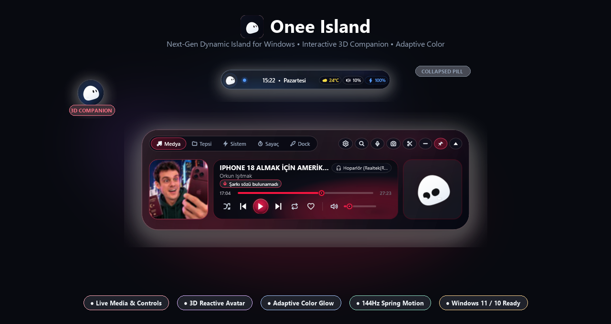
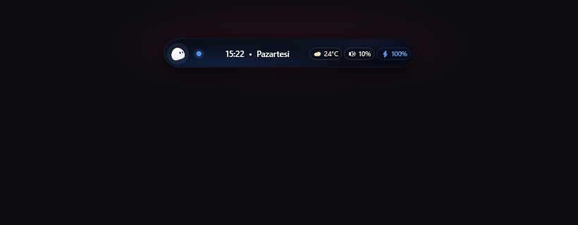
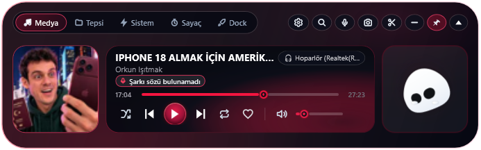

<div align="center">
  
  <h1>🏝️ Onee Island (Dynamic Island for Windows)</h1>
  <p><strong>A hardware-accelerated, fluid Apple Dynamic Island & living 3D desktop companion for Windows 11 & 10.</strong></p>

  <p>
    
    
    
    
    <a href="https://www.buymeacoffee.com/NovaCarpeDiem"></a>
  </p>

  <br />
  
</div>

<br />

---

## 🎬 Live Animation Showcase

<div align="center">
  
  <p><em>Seamless spring physics expansion, media playback controls, and living 3D avatar animations.</em></p>
</div>

---

## ✨ Key Features

### 🐾 Onee — The Living Desktop Companion
* **3D Interactive Emotions:** Real-time physics reactions, pokes, pets, sleep cycles, and cursor eye tracking.
* **Music Synchronization:** Onee dances and bobs rhythmically to playing tunes wearing custom DJ headphones.
* **Mini Detached Companion Mode:** Right-click anytime to detach Onee into an interactive floating desktop orb that can be placed anywhere on screen.

<div align="center">
  
  <p><em>Detached Floating 3D Companion Orb</em></p>
</div>

---

### 🎵 Adaptive Glassmorphic Media Player
* **Universal SMTC Integration:** Works natively with Spotify, YouTube, Chrome, Edge, Apple Music, and Windows Media Player.
* **Dynamic Color Aura:** Intelligently extracts dominant album artwork hues to illuminate the island with fluid ambient backlights.
* **Live Karaoke Lyrics:** Real-time synchronized lyrics display with fullscreen karaoke overlay.
* **Ultra-Responsive Controls:** Smooth volume wheel adjustment on the notch bezel and scrubbable timeline seek bar.

<div align="center">
  
</div>

---

### ⚡ Built-in Productivity Suite
* **Spotlight Launcher & Calculator (`Alt + Space`):** Instant app search, web shortcuts, and live math calculations.
* **Drop Shelf & Clipboard:** Drag-and-drop file holding shelf and automatic clipboard history.
* **Live Hardware Monitor:** Real-time CPU, RAM, battery charging pulse, and network statistics.
* **Pomodoro Focus Timer:** Gamified focus sessions with circular countdown rings and sound rewards.
* **Smart Region Snip:** Integrated screenshot tool with quick-copy to clipboard.

<div align="center">
  
  <p><em>Compact Pill Mode with Live Weather, Time & Hardware Stats</em></p>
</div>

---

## ⌨️ Controls & Shortcuts

| Action | Gesture / Shortcut | Description |
| :--- | :--- | :--- |
| **Expand Island** | `Left Click` on pill | Opens full media, widgets, and system dashboard |
| **Collapse Island** | `Click Outside` / `▲` | Retracts back to compact notch pill |
| **Mini Avatar Mode** | `Right Click` on pill / Onee | Detaches 3D avatar into floating mini desktop companion |
| **Adjust Volume** | `Mouse Wheel` on notch | Changes system volume with glowing bezel meter |
| **Spotlight Search** | `Alt + Space` / Search icon | Opens instant universal launcher |
| **Move Position** | `Click & Drag` pill | Reposition island horizontally on your monitor |

---

## 🚀 Installation & Quick Start

### Prerequisites
* **Windows 10 (Build 19041+)** or **Windows 11**
* [.NET 10 Desktop Runtime](https://dotnet.microsoft.com/download)
* WebView2 Runtime *(pre-installed on Windows 11)*

### Run from Source
```bash
# Clone repository
git clone https://github.com/NovaCarpeDiem/OneeIsland.git
cd OneeIsland

# Build Release binary
dotnet build -c Release

# Launch application
dotnet run -c Release
```

*Or simply run `Baslat.bat` to launch immediately!*

---

## ☕ Support & Sponsorship

If you enjoy **Onee Island** and would like to support continuous development, new features, and animations:

<p align="center">
  <a href="https://www.buymeacoffee.com/NovaCarpeDiem" target="_blank">
    
  </a>
</p>

- ⭐ **Star this repository:** Helping the project gain visibility on GitHub means the world!
- ☕ **Buy Me a Coffee:** Support development directly at [buymeacoffee.com/NovaCarpeDiem](https://www.buymeacoffee.com/NovaCarpeDiem).

---

## 📄 License
This project is open-source under the [MIT License](LICENSE).
Feel free to fork, customize, and contribute!
